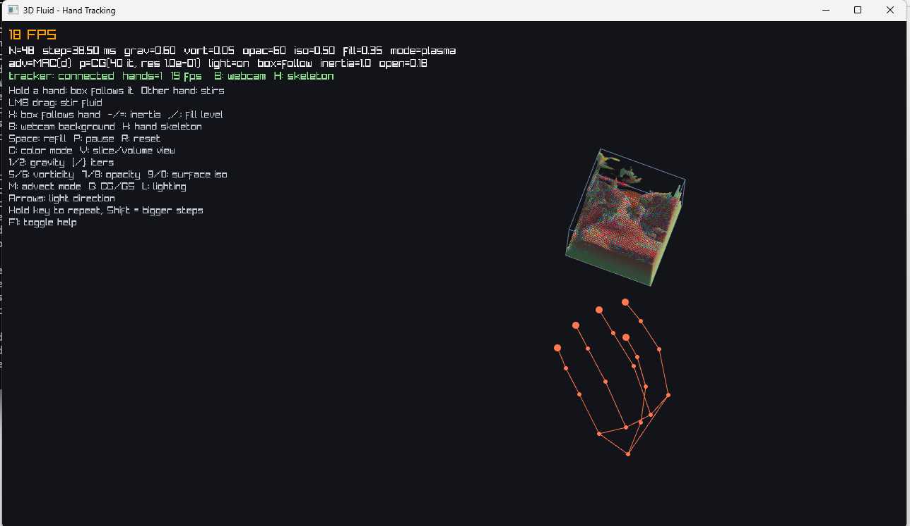

# 3D Fluid - Hand Tracking

Hold a glass box of liquid in your hand. Your webcam tracks your hands. A 3D fluid box floats just
above the fingertips of one hand and moves, tilts and resizes with it. The liquid inside falls under
real gravity, pools on whichever side is down, and sloshes when you move the box. Your other hand can
reach into the box and stir it.



It is built on the Stable Fluids solver from [`../fluid`](../fluid) (48³ grid, raylib, GPU ray
marching). Hand tracking comes from [MediaPipe Hand Landmarker](https://developers.google.com/edge/mediapipe/solutions/vision/hand_landmarker),
which runs in a small Python sidecar.

## Requirements

- Windows with a webcam
- Python 3.9+ on `PATH` (tested with 3.13)
- [w64devkit](https://github.com/skeeto/w64devkit) g++ and raylib 5.5 built as a static library, with
  the same layout as `../fluid`:
  ```
  C:\raylib\w64devkit\bin\g++.exe
  C:\raylib\raylib\src\        (raylib.h, raymath.h, rlgl.h, libraylib.a)
  ```
  If your paths are different, edit `GXX` and `RAYLIB` at the top of `build.bat`.

## Setup

```bat
setup.bat
build.bat
```

`setup.bat` only needs to run once. It:

- creates a private virtual environment in `.venv`, so MediaPipe's OpenCV dependency can't clash with
  the packages in your global Python;
- installs `requirements.txt` (`mediapipe==1.2.3`, `opencv-python`);
- downloads the hand model `hand_landmarker.task` (about 8 MB).

`build.bat` compiles `main.cpp` and `net.cpp` into `fluid_hands.exe`. It uses OpenMP if the compiler
supports it.

## Running

```bat
fluid_hands.exe
```

The app starts `tracker.py` in the background and closes it when you quit. Your mirrored webcam image
appears dimmed behind the box. It can take a few seconds for MediaPipe to start; until then the HUD
shows `tracker: waiting`.

- **Holding the box.** Raise one hand. After about 0.2 s it picks up the box. The box floats just
  above your highest fingertip and turns as your hand turns. Open your hand to make the box bigger;
  close it into a fist to make it smaller. Moving your hand closer to the camera also makes it bigger.
- **Gravity.** The box is sealed and holds a fixed amount of liquid (35% of its volume to start).
  Gravity always pulls towards the bottom of the screen, so tilting or flipping the box pours the
  liquid to the new low side.
- **Inertia.** When you jerk or spin the box, the liquid lags behind and sloshes, like shaking a jar.
- **Stirring.** A second hand stirs the liquid with its fingertips and palm while they are inside the
  box. The harder you move, the harder it stirs. Stirring never adds or removes liquid.
- **Letting go.** Drop your hands and the box drifts back to the centre, upright.

### Controls

Parameter keys repeat while held. Hold Shift for bigger steps.

| Key       | Action                                                                  |
|-----------|-------------------------------------------------------------------------|
| LMB drag  | Stir the liquid with the mouse (on the slice plane in slice view)       |
| X         | Box follows your hand on/off                                            |
| B         | Webcam background on/off                                                |
| H         | Hand skeleton overlay on/off                                            |
| Space     | Refill: reset the liquid to a flat layer on the current bottom          |
| R         | Reset the simulation (also refills)                                     |
| P         | Pause                                                                   |
| , / .     | Fill level −/+ 0.05 (Shift 0.15), range 0.05–0.8. Refills the box       |
| 1 / 2     | Gravity −/+ 0.05 (Shift 0.25), range 0–2, default 0.6                   |
| - / =     | Inertia (slosh strength) −/+ 0.1 (Shift 0.5), range 0–2, default 1.0     |
| 5 / 6     | Vorticity confinement −/+ 0.2 (Shift 1.0), default 0.05                  |
| 7 / 8     | Opacity ÷/× 1.25 (Shift 2), range 5–300, default 60                     |
| 9 / 0     | Surface threshold −/+ 0.05 (Shift 0.15), range 0.15–0.85, default 0.5    |
| [ / ]     | Pressure-solver iterations                                              |
| C         | Color mode: smoke / fire / plasma (default) / classic                   |
| V         | Slice view: a cross-section through the middle of the box, drawn inside the box |
| M / G / L | Advection mode / CG or Gauss-Seidel pressure solver / lighting          |
| Arrows    | Light direction                                                         |
| F1        | Help overlay                                                            |

The HUD shows the tracker status and rate, the number of tracked hands, and how open the holding hand
is (`open=`, where 0 is a fist and 1 is fully open).

### Command-line options

| Flag                  | Effect                                                               |
|-----------------------|----------------------------------------------------------------------|
| `--cam N`             | Use webcam N (default 0)                                             |
| `--port N`            | UDP port for tracker data (default 9876)                             |
| `--no-tracker`        | Don't start `tracker.py`; run it yourself instead                    |
| `--fake`              | Use simulated hands and a synthetic background instead of the webcam |
| `--mode <0-3>`        | Starting color mode                                                  |
| `--restsize S`        | Box size when no hand holds it (default 0.6; 1 fills the window height) |
| `--inertia K`         | Starting inertia factor                                              |
| `--sliceview`         | Start in slice view                                                  |
| `--gs` / `--sl` / `--nolight` | Gauss-Seidel solver / semi-Lagrangian advection / no lighting |

These options are for testing and benchmarking:

| Flag                  | Effect                                                               |
|-----------------------|----------------------------------------------------------------------|
| `--soak N`            | Run N frames without the frame cap, print solver/tracker stats every 100 frames, save `soak_hands.png` (or `soak_slice.png`) and exit |
| `--testslosh`         | Scripted test with no tracker: jerk the box sideways, turn it 90°, then 90° more (upside down). Prints total mass and how far the liquid sits towards the bottom; saves `testslosh_545.png` and `testslosh_640.png` |
| `--testdrag`          | Simulated circular mouse drag between frames 300 and 600             |
| `--screenshot` / `--screenshot-slice` | Run 180 frames, save `shot.png` / `shot_slice.png`, print solver metrics |
| `--forces 0/1/2`      | Inertia model: 0 full-box, 1 sideways push weighted by density (default), 2 rotation also weighted |
| `--curlphase T`       | Shift the timing of the simulated hand opening and closing (with `--fake`) |

`tracker.py` can also be run on its own:

```bat
.venv\Scripts\python tracker.py --frames 150
```

| Flag              | Effect                                                    |
|-------------------|-----------------------------------------------------------|
| `--cam N`         | Webcam index                                              |
| `--port N`        | UDP port                                                  |
| `--fake`          | Simulated hands (does not import MediaPipe)               |
| `--frames N`      | Exit after N frames and print average fps and how many frames had a hand |
| `--stream-width W`| Width of the webcam image sent to the app (default 320)   |
| `--model PATH`    | Hand model path (default `hand_landmarker.task` next to the script) |
| `--log FILE`      | Write output to a file (the app uses `tracker.log`)       |
| `--download-only` | Download the model and exit                               |

## How it works

### Tracker → app

`tracker.py` captures 640×480 webcam frames, mirrors them, and runs MediaPipe Hand Landmarker for up
to two hands. Each frame it sends UDP datagrams to `127.0.0.1` only:

- **`HND2`**: camera aspect ratio, then for each hand: left/right, score, 21 image landmarks
  (normalized x, y, z) and 21 world landmarks (metres).
- **`IMG1`**: the mirrored RGB frame scaled to 320 px wide, split into row chunks that each fit in one
  datagram.

`net.cpp` holds all the Windows-specific code: Winsock and process launching. It is kept out of
`main.cpp` because `windows.h` clashes with raylib's names. Each frame it reads every waiting packet
without blocking. It also starts the tracker inside a Windows Job object, so the tracker can't outlive
the app, even after a crash.

### Hands → box

- **Slots.** Detected hands are matched to two slots by nearest palm centre. Fingertip and palm
  positions are smoothed, and their velocities are tracked.
- **Holder.** The slot that has been active longest holds the box. It must be active for at least
  0.2 s first, and it may drop out for up to 0.3 s without letting go.
- **Rotation.** An orientation frame is built from the world landmarks (wrist to middle knuckle, index
  knuckle to pinky knuckle, palm normal). The box turns by however much your hand has turned since you
  grabbed it, so it never snaps.
- **Size.** Openness is the average fingertip-to-wrist distance divided by the wrist-to-middle-knuckle
  distance (about 1.0 for a fist, about 1.9 for an open hand). It scales the box between fist size and
  open-hand size.
- **Smoothing and framing.** Position, rotation and size are eased every frame, and the box is kept
  fully on screen.

### Solver changes (vs `../fluid`)

- **Closed box.** The top face is sealed. This makes the pressure equation singular, so the mean is
  removed from the pressure solve's input and result.
- **Gravity.** The buoyancy term is reused as gravity (`buoyancy = -gravity`), along world "up"
  expressed in box coordinates.
- **Inertia.** Each frame, the box's change in velocity and its spin (Euler, Coriolis and centrifugal
  terms) are applied to the fluid as forces in the box's frame. By default the sideways push is
  weighted by density, so the liquid lags behind while the empty space doesn't.
- **Sharp surface and constant mass.** After density advection, an Allen–Cahn-style term
  (`d += 0.15·4·d(1−d)(d−0.5)`) pushes partly filled cells back towards 0 or 1 to counter numerical
  blurring. Then a correction weighted by `d(1−d)` puts back any gained or lost mass at the surface,
  so the total stays constant (within about 0.1% in `--testslosh`).
- **Rendering.** The volume shader ray-marches in box coordinates using the inverse box transform. It
  draws the liquid as a high-opacity surface: a `smoothstep` around the surface threshold `iso`.
- **CPU threads.** OpenMP leaves two CPU cores free for the tracker.

## Files

```
main.cpp            solver, shaders, hand/box logic, app loop
net.h / net.cpp     UDP receiver + tracker process launch (Winsock, Job object)
tracker.py          webcam + MediaPipe hand tracking sidecar (also --fake mode)
requirements.txt    pinned Python dependencies
setup.bat           creates .venv, installs dependencies, downloads the model
build.bat           builds fluid_hands.exe
*.png               screenshots from the test modes
```

## Troubleshooting

- **HUD says `tracker: waiting (see tracker.log)`.** Open `tracker.log`. The tracker takes a few
  seconds to start, so wait first.
- **`could not open camera` in `tracker.log`.** Another app is using the camera, or Windows is
  blocking it. Check Settings → Privacy & security → Camera, and allow desktop apps. Try `--cam 1` if
  you have more than one camera.
- **`failed to launch tracker.py` warning.** Run `setup.bat`. Or start
  `.venv\Scripts\python tracker.py` yourself and run the app with `--no-tracker`.
- **Low tracker rate or FPS.** Hand tracking and the solver share the CPU, so close other heavy
  programs. `[` lowers the solver iterations; `-` lowers the inertia, which reduces solver work while
  the box moves.
- **The box jitters.** Hand rotation from a webcam is noisy, especially with the palm edge-on to the
  camera. Hold your palm facing the camera, or press X to stop the box following your hand.
